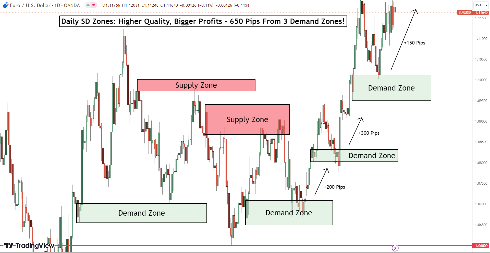
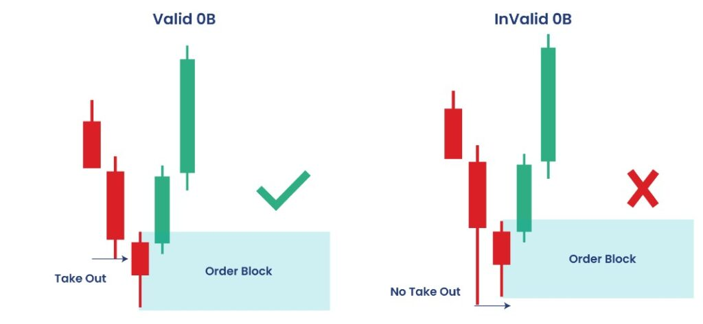
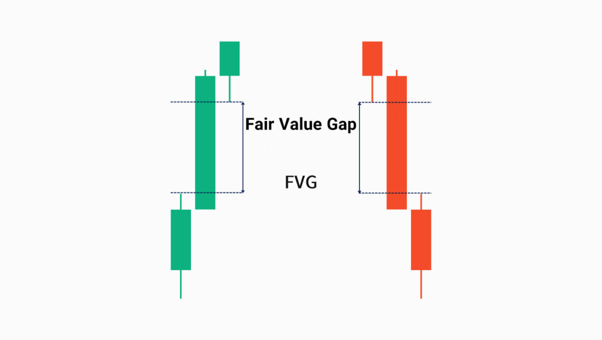
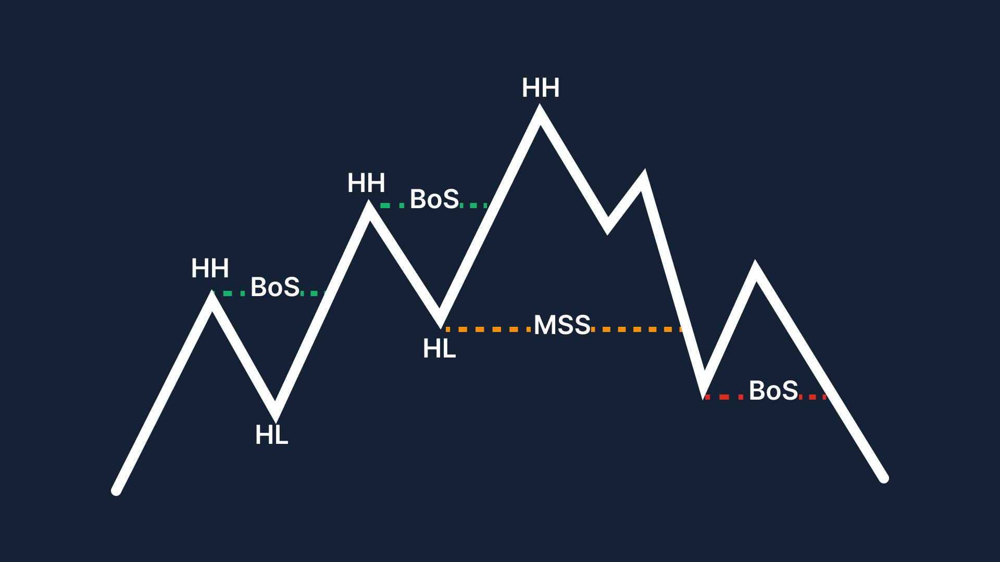

## Volatility and Bollinger Bands
Volatility is the lifeblood of trading, and mastering it can be the key to unlocking consistent performance. For traders, Bollinger Bands (BB) indicator offers a powerful way to navigate market swings by capturing volatility in real-time.

**Bollinger Bands** are a popular technical analysis tool used by traders to assess market volatility and identify potential price reversals. This indicator consists of three lines: a middle band, which is a simple moving average (SMA), and two outer bands that are typically set two standard deviations away from the SMA. The outer bands expand when volatility increases and contract when volatility decreases, creating a visual representation of market momentum. 

Traders use Bollinger Bands to spot overbought or oversold conditions, as prices nearing or crossing the outer bands often signal potential reversals or breakout opportunities. Trading volatility using Bollinger Bands revolves around the concept of market overreactions. The bands themselves expand and contract based on market volatility, offering a visual representation of price movement. When the price moves outside of the bands, it indicates a period of increased volatility. Prices closing above the upper band signal overbought conditions, meaning the market may have moved too far upward too quickly. Conversely, when the price dips below the lower band, it suggests oversold conditions, where the market may have overreacted to the downside. The idea behind trading volatility with Bollinger Bands is that extreme price movements outside the bands often lead to reversals. When the bands widen, volatility increases, and when the bands tighten, the market is calmer. By monitoring these conditions, traders can identify potential turning points in the market.

A naive strategy to trade using BB is: Enter a long position when the price closes below the lower Bollinger Band, signifying an oversold condition. Exit the trade when the price reaches the middle Bollinger Band (SMA), which often indicates that the price has reverted to its mean. This kind of strategy works well if the stock is mean reverting. So for better performance, take positions when the middle band is flat, instead of trending. 

## Moving Average Convergence Divergence (MACD)
Catching a trend during its initial phase is crucial for maximizing profits and minimizing risks in trading, as it allows you to capitalise on the majority of a trend's movement before it becomes widely recognised. To achieve this, traders often rely on technical indicators, with one of the most effective being the Moving Average Convergence Divergence (MACD). 
MACD is based on the principle of moving average crossovers. Crossovers are widely used to signal a change in the trend.

In the above price graph, you can see that there are blue and orange lines. The MACD gives a buy signal when the blue line crosses the orange line from below. This crossover indicates the beginning of a bullish trend. Along with the blue and the orange line, you can see a lot of things in the graph. Like the green and red bars of varying shades. What are the lines and bars? Let us see the components and detailed working of MACD. To compute the divergence between the moving averages, we first need to calculate the short-term and long-term moving averages. We can either calculate a simple moving average or an exponential moving average. For illustration, we will calculate the exponential moving average. The two moving averages tell us about the movement in the price series. The 12-period EMA tells us about the price movements in the short term. And the 26-period EMA tells us about the price movements in the long term. The 12-period EMA would be more sensitive to the recent price changes, and the 26-period EMA would be less sensitive. In an up-trending market, the 12-period EMA will move up faster than the 26-period EMA. And in a down-trending market, the 12-period EMA will fall faster than the 26-period EMA. After calculating the two moving averages, we will calculate the difference between them. As the difference increases, it indicates that the two moving averages are moving away from each other or are diverging. And the trend is growing stronger. A positive divergence indicates an up trend, and a negative divergence indicates a downtrend. The difference between the short-term and long-term moving average is called the MACD line. This line is the first component of the MACD indicator and is shown using the blue line in the below graph.

If the MACD line is rising, then it indicates a positive trend. To determine if the MACD line is rising, we will compare the MACD line value with its own moving average. The moving average of the MACD line is called the signal line. It is shown using the orange line and is typically computed using a 9-period moving average. As a general rule, we can buy an asset when its MACD line crosses above the signal line. Similarly, we can sell it when the MACD line crosses below the signal line. The third component of MACD is MACD histogram. You can see the green and the red bars of varying height along with the MACD and the signal line. The height of the bar represents the difference between the two lines (MACD line and signal line). The longer the bar, the farther the lines. If the MACD line is above the signal line, the difference is positive. In this case, the bar is above the baseline or zero line and it is green in colour. Otherwise, it is below the baseline and is red. But what are the varying shades of the bars? If you take a closer look at the bars, you will see that if the bar is longer than the previous bar, it has a darker shade. Otherwise, it is light. Therefore simply by looking at the height and the colour of the histogram, you can say whether the two lines are moving towards each other or away from each other. If the lines are moving towards each other, they are said to be converging. And if they are moving away from each other, they are said to be diverging. Hence, we have the name Moving Average Convergence Divergence. If the shade of the bar is dark the trend is growing stronger. And if it is light, the trend is getting weaker.

## What is Implied Volatility ?
In finance, volatility is the degree of variation of a price time series, such as the closing prices of a particular asset (BTC, XAU etc.). It is measured by the standard deviation. Volatility refers to the uncertainty or risk associated with a security’s value and is not concerned with the direction of change but with the amount of change. Volatility is an essential variable for pricing contracts. It also indicates the extent to which the underlying asset's price may fluctuate between the present and the expiration date of the contract. 

By understanding imbalances in supply and demand, implied volatility represents the expected fluctuations of the underlying security till the expiration of the contract. Implied volatility results from buying and selling pressure in the market and is a forward-looking metric.

Options (buying or selling an asset) with high implied volatility levels will result in high-priced option premiums. Conversely, implied volatility will decrease as the market's expectations decrease or demand for an option diminishes. Options containing lower levels of implied volatility will result in cheaper option prices. This is important because the rise and fall of implied volatility will determine how expensive or cheap time value is to the option, which can, in turn, affect the success of an options trade.

Forecasting Implied Volatility (IV) can help traders make more informed decisions about buying and selling options. It can also help risk managers to better assess and manage the potential risks associated with their portfolios. Additionally, implied volatility is used as an input in various option pricing models. Hence forecasted IV can be used to price options more accurately.

In simple terms, High IV indicates the market expects large price swings often due to upcoming earnings reports, product launches, or macro events. Higher IV makes option premiums more expensive. Low IV indicates the market expects quiet, steady price action. Lower IV makes option premiums less expensive. 

## Neural Networks
I skip introducing NN and jump into the use case. The whole process for developing a NN-based learning system is as follow: We start with a fixed number of features. Suppose, we want to train the NN on AAPL (Apple stock) data from Jan of 2018 till mid-March 2023 and test the network using the data from mid-March 2023 to June of 2024. Knowing that the feature engineering has been done at this point, we start with 5-feature data feed. The features are: Previous day closed price, average closed price of the past 5 days, Relative volume, High-low and open-close. We then feed each feature to one neuron of the MLP. Note that the number of the neurons of the first hidden layer is exactly the same as the number of features. 

This network is trained using the training dataset and then testing data is passed into the neural network to generate the predictions. For example, Enter a long position when the neural network predicted ‘1’, otherwise, not. The idea then is that, to increase the accuracy of our model, we can increase the number of feature one at a time and analyze the accuracy of it. The goal is to add complexity and observe how accurate our model is in trainig and testing. Eventually, we try to find the sweet spot where the training, testing and overall error of the model is minimum. 

## Smart Money Concept
the Smart Money Concept (SMC), a trading approach focusing on institutional footprints rather than traditional price action. It outlines key concepts such as order blocks, fair value gaps, and liquidity grabs to decode market imbalances. By understanding these vital concepts, traders can make informed decisions and capitalize on high-probability trading opportunities. Unlike traditional retail strategies, which rely on basic price action and indicators, SMC dives into market structure shifts, order blocks, liquidity grabs, and fair value gaps (FVGs) to track the footprints of big players like banks and hedge funds. SMC is a sophisticated trading strategy that focuses on understanding and anticipating the actions of institutional investors often referred to as “smart money” who have the resources and knowledge to significantly influence market trends. It involves identifying and interpreting the footprints of these institutional players, allowing retail traders to align their strategies with the dominant market forces. By understanding how these “big fish” operate, retail traders can potentially improve their odds of success and navigate the market with greater confidence.
The core principles of SMC trading revolve around:

1) Supply and Demand Dynamics: SMC emphasizes understanding the imbalances between supply and demand created by institutional orders. These imbalances create zones of high buying or selling pressure, which can be identified on price charts.

2) Institutional Activity: The focus is on recognizing and analyzing the behaviors of institutional investors, whose large trades have a notable impact on market direction.
3) Market Imabalance: SMC pinpoints how institutional orders due to their size create imbalances that propel price movements in specific directions.
By understanding these core principles, traders can pinpoint high-probability trading opportunities and refine their decision-making processes.

Below are the core SMC concepts, along with detailed guidance on how to recognize them during chart analysis. 
| Concept | Description |
|---|---|
| **Order Block** | A price level where large institutional orders are placed, often visible as clusters of candles with high volume near key swing highs/lows or support/resistance. Institutional Footprint: These zones indicate where large buy or sell orders were placed, creating significant price reactions.|
| **Fair Value Gap (FVG)** | A gap on the chart indicating an imbalance between supply and demand, often acting as a magnet for price to return and fill. |
| **Liquidity Grab** | A sudden price move designed to trigger stop-loss orders placed by retail traders, creating opportunities for smart money to accumulate or distribute positions. |
| **Breaker Block** | A failed order block that signals a potential trend change when price breaks through it and continues in the opposite direction. |
| **Mitigation Block** | A zone where price retests a previous breakout level after a sharp move, helping confirm the validity of the breakout and the trend's strength. |
| **Break of Structure (BOS)** | Occurs when price decisively breaks above a significant swing high or below a significant swing low, indicating a potential market trend shift. |
| **Change of Character (ChoCH)** | A notable change in market behavior, often observed after a BOS, confirming a potential trend reversal. |
| **Accumulation/Distribution** | Phases in a market cycle where smart money quietly accumulates (buys) or distributes (sells) positions, often based on Wyckoff's schematics. |

* Break of Structure (BOS) & Market Structure Shifts (MSS)
BOS occurs when price decisively breaks above a significant swing high in an uptrend or below a significant swing low in a downtrend, signaling the continuation of the prevailing trend. MSS (Market Structure Shift) occurs when price breaks structure against the current trend. In a downtrend, this means price breaks above the most recent lower high; in an uptrend, it means price breaks below the most recent higher low. This counter-trend break serves as an early warning that the market’s directional bias may be shifting.

Key Distinction:

BOS = Structure break aligned with the trend, confirming momentum and trend continuation.

MSS = Structure break opposing the trend, suggesting potential reversal and often marking the initial phase of a trend change.

Significance: While BOS validates that institutional players remain committed to the existing trend, MSS provides a critical early signal that smart money may be repositioning. An MSS often precedes a full trend reversal and is typically followed by a Change of Character (ChoCH), which further confirms the shift in market sentiment. Recognizing MSS allows traders to anticipate reversals before they become obvious to the broader market, positioning themselves ahead of the crowd.

When an MSS is identified, traders should look for confluence with other SMC concepts such as order blocks, fair value gaps, or liquidity grabs at the MSS level. This combination increases the probability of a successful reversal trade. However, it’s prudent to wait for additional confirmation through a ChoCH or a bullish/bearish engulfing candle before entering counter-trend positions.

One of the most powerful yet underutilized strategies in Smart Money Concepts is multi-timeframe analysis. While some traders rely solely on one chart period, SMC traders use a multi-timeframe approach to get a complete picture of the market, examining both the broader picture and finer details. This systematic approach significantly increases trading accuracy and helps traders avoid counter-trend trades that often result in losses.

### SMC Framework for trading (strategy)
* Step 1: Identify Market Trend on Higher Timeframes: We begin our analysis on high time frames (1H or 4H) to understand the primary trend and major structural levels. Specifically, we look for 
- Significant swing highs and swing lows
- Key supply and demand areas
- Order blocks where institutions have placed large orders
- Break of Structure (BOS) or Change of Character (ChoCH) signals

For most traders, the hourly (H1) timeframe is perfect for market structure analysis as it reduces noise while providing enough trading opportunities.

* Step 2: Define Key SMC Zones and Structures: Once we've identified the trend, mark critical zones on our higher timeframe chart
- Order blocks that caused significant price reactions
- Fair Value Gaps (FVGs) that haven’t been filled
- Liquidity pools at equal highs/lows
- Premium and discount zones using Fibonacci levels (0.62-0.79 retracement)

These higher timeframe zones become our “areas of interest” where we’ll look for lower timeframe confirmations.

* Step 3: Fine-Tune with Lower Timeframes: Use a lower timeframe like the 15-minute (typically for 4H) or 5-minute (typically for 1H) chart to pinpoint precise entry and exit signals, focusing on smaller price movements and patterns that indicate optimal trade entry. The lower timeframe should be used solely for timing, while overall decision-making remains guided by higher timeframe analysis.
On our lower timeframe, watch for:
- Internal Break of Structure (BOS) or ChoCH confirming direction
- Price reactions within higher timeframe order blocks
- FVG formations aligned with the higher timeframe bias
- Engulfing candles or strong rejection wicks

### Algorithmical implemenation of SMC
1) Data Acquisition
Gather historical price data with OHLCV (Open, High, Low, Close, Volume) information. Use reliable APIs or data providers to access real-time and historical market data.

2) Identify Key Levels in high timeframe

- Develop algorithms to spot swing highs and lows, vital for defining market structure.
- Detect support/resistance levels based on price action, order flow, and possibly moving averages.
- Identify psychological levels (round numbers) that often serve as interest areas for traders.

3) Recognize SMC Patterns

- Order Blocks: Code detection logic using candlestick patterns (e.g., engulfing bars), volume spikes, and price consolidation before breakouts.
- Fair Value Gaps: Programmatically scan for rapid price movements that create visible gaps between candles.
- Liquidity Grabs: Look for sudden spikes near key levels and false breakouts. Indicators like RSI or Bollinger Bands can help.
- Breaker Blocks: Identify failed order blocks and changes in market structure, using BOS and ChoCH concepts.
- Mitigation Blocks: Analyze price retracements and consolidation after breakouts, possibly with Fibonacci retracement levels.

4) Incorporate Order Flow Analysis
- Integrate real-time order flow data to confirm institutional activity at identified SMC zones.
- Monitor order book depth, trade volume, and bid-ask spreads for early signals of potential liquidity grabs or major institutional entries.