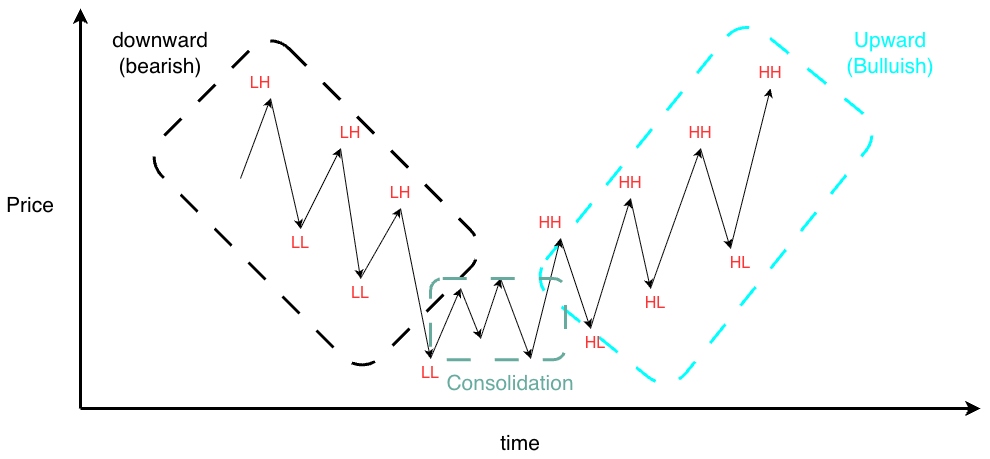
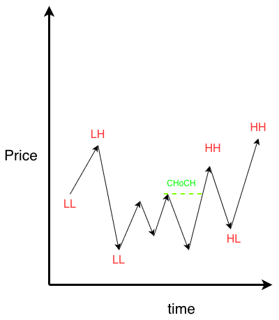
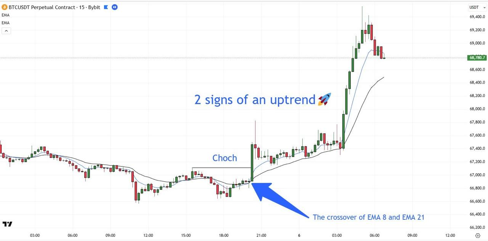
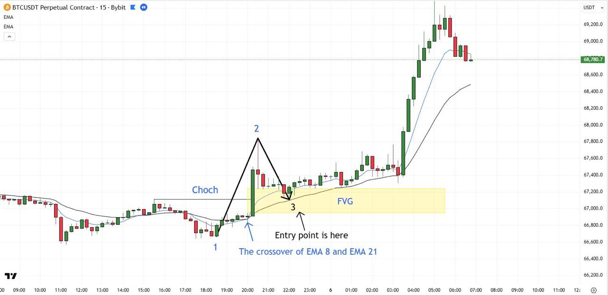

# List of strategies to predict the price trend

Here, I will list the valid strategies that most traders use to predict the trend manually.

# 1) EMA–CHoCH–FVG Trading Strategy
This strategy uses two confirmation for the price prediction: Using EMA8 and EMA21, and Change of Character (ChoCH). The strategy runs as a sequence of states. The agent only moves to the next state when the current condition is met, and it resets to the start if the setup is invalidated:

1) Monitor: track price, EMA8 and EMA21 on every closed candle.

2) **Signal 1**: EMA8 crosses above EMA21: The indicator of the upward trend. EMA8 crosses below EMA21: the indicator of downward trend. 

3) **Signal 2**: price confirms a CHoCH by closing above or below the last swing. If EMA8 has crossed above EMA21, and the current candle closes above the last peak, it is the confirmation of the upward trend. If EMA8 has crossed below EMA21 and the current candle closes below the last trough, it is the confirmation of the downward trend. 

4) **Wait**: mark the Fair Value Gap left by the impulse and wait for price to return to it.

5) **Entry**: price touches the FVG while EMA8 is still above EMA21, so the agent predicts high.

The example throughout is BTC/USDT perpetual on the 15-minute chart. The same logic applies to any liquid asset and timeframe, with parameters re-tuned.

## Step 1: Monitor price: EMA8 and EMA 21

The agent constantly monitors the price of the asset (say BTC/USDT) along with two indicators: EMA8 and EMA21. All decisions are made on closed candles only, so a signal cannot appear and then disappear inside a candle.

A simple moving average (SMA) of length N is the plain average of the last N closing prices. It smooths out noise so you can see the direction of price. Its weakness is that every candle in the window counts equally, so it reacts slowly to new moves. An Exponential Moving Average (EMA) also averages recent closes, but gives more weight to the newest candles. The weight of older candles decays exponentially. It is computed recursively on each new close:

$$
EMA_t = \alpha \cdot Close_t + (1 - \alpha) \cdot EMA_{t-1}, \qquad \alpha = \frac{2}{N + 1}
$$

α is the weight given to the newest close. For N = 8, α = 2/9 ≈ 0.22. For N = 21, α = 2/22 ≈ 0.09. The new EMA is 22% today's close plus 78% yesterday's EMA (for EMA8), or 9% today's close plus 91% yesterday's EMA (for EMA21). A larger α means the line follows price more tightly. A smaller α means it is smoother and slower. EMA8 reflects roughly the last 8 candles, which is 2 hours on a 15-minute chart. It captures short-term momentum. EMA21 reflects roughly the last 21 candles, which is about 5 hours. It captures the local trend. Their relative position tells you about momentum. When EMA8 is above EMA21, recent prices are higher than the longer-run average, so short-term momentum is upward (bullish). When EMA8 is below EMA21, it is downward (bearish).

## Step 2: Signal 1, the EMA8/EMA21 crossover

Once EMA8 crosses above EMA21, the first signal of an upward price movement is triggered. The agent records the crossover candle and starts looking for the second signal. A bullish crossover happens on candle t when both conditions hold:
1. On the previous candle, EMA8 was at or below EMA21: EMA8(t−1) ≤ EMA21(t−1).
2. On the current closed candle, EMA8 is above EMA21: EMA8(t) > EMA21(t).

The fast average only rises above the slow average when recent closes are noticeably higher than the older ones. So the crossover says that short-term momentum has flipped from bearish to bullish. However, The crossover is a **lagging signal**. Both lines are built from past prices, so they cross after the move has started. In sideways markets the two lines intertwine and produce many false crossovers. That is why the agent does not trade on the crossover alone and requires a structural confirmation next. The crossover and the CHoCH should happen close together. If the CHoCH does not appear within a set number of candles after the crossover (a parameter, for example 8 candles), the signal expires and the agent returns to Step 1. This gap is something we should find with propoer training models.

## Step 3: Signal 2, Change of Character (CHoCH)

After the crossover, the agent looks for a Change of Character: For example, a candle that closes above the most recent swing high of the downtrend (just like in the picture). This confirms that market structure, not just momentum, has turned bullish. The same exact story is applied to the bearish trend. 

* Building block 1: swing highs and swing lows
A swing high is a local peak: a candle whose high is higher than the highs of the k candles on each side. A swing low is the mirror image, a local trough. k is a parameter (for example k = 3 on the 15-minute chart). Note that a swing is only confirmed k candles after it forms, because the agent needs to see the candles to its right. k is a value that should also be empirically optimized. 

* Building block 2: market structure
Price moves in waves, and the sequence of swings defines the trend:

   * Downtrend: lower highs (LH) and lower lows (LL). Each bounce fails below the previous one.

   * Uptrend: higher highs (HH) and higher lows (HL). Each pullback holds above the previous one.

   * Consolidation: Price does not show any meaningful trend. Basically, it bounces back and forth between two ranges.

What a CHoCH is:

In a downtrend, the most recent lower high is the level sellers last defended. As long as price stays below it, the sequence of lower highs is intact. When a candle closes above that level, the downtrend pattern is broken: the market has changed its character from bearish to bullish.

The crossover only measures averages. A CHoCH means buyers pushed price through a level where either buyers or sellers had previously won. A strong, large-bodied candle through the level (displacement) suggests urgent, large-size buying/selling. This is what traders call smart money: large participants whose orders move price decisively.

Once the crossover has fired, track the last confirmed swing high formed before it. If a candle closes above that level within the timing window, Signal 2 is confirmed. Record the impulse candle, the swing low before it (point 1) and the high the impulse reaches (point 2).

## Step 4: Mark the Fair Value Gap and wait for the retest

At this point we know price has moved deliberately, which suggests large players are active. The agent does not buy the impulse. It marks the Fair Value Gap the impulse left behind and waits for price to come back to it. 

What a Fair Value Gap is ?

An FVG is a price range that was crossed so fast that almost no trading happened there in both directions. It is defined with three consecutive candles, where candle 2 is the big impulse candle:
1. Take the high of candle 1 (the candle before the impulse).
2. Take the low of candle 3 (the candle after the impulse).
3. If low(candle 3) > high(candle 1), there is a bullish FVG. The zone runs from high(candle 1) at the bottom to low(candle 3) at the top.

In plain words: the wicks of the candles on either side of the impulse do not overlap. 

Why price tends to return to it ?

The usual reasoning is that the gap represents an imbalance. In this example, buyers overwhelmed sellers so quickly that many resting orders in that range were never filled. Price **often** returns to "rebalance" the area before continuing. If the move up was genuine, buyers defend the zone, so it acts as support. 

The FVG gap should be large enough to matter. Tiny gaps are noise. Also, FVG should be created by the same impulse that produced the CHoCH, not by an unrelated candle.

Waiting rules:

* The agent waits for price to trade back down into the zone, meaning a candle's low reaches the top of the FVG.
* If price closes below the bottom of the FVG, the zone has failed and the setup is cancelled.
* If price does not return within a maximum number of candles (a parameter, for example 48 candles, or 12 hours on the 15-minute chart), the setup expires.

## Step 5: Entry

As soon as price touches the FVG, the agent checks one last condition: EMA8 must still be above EMA21. If it is, the bullish momentum is intact and the agent predicts upward (bullish) trend. If EMA8 has already crossed back below EMA21, momentum has failed and the setup is cancelled.