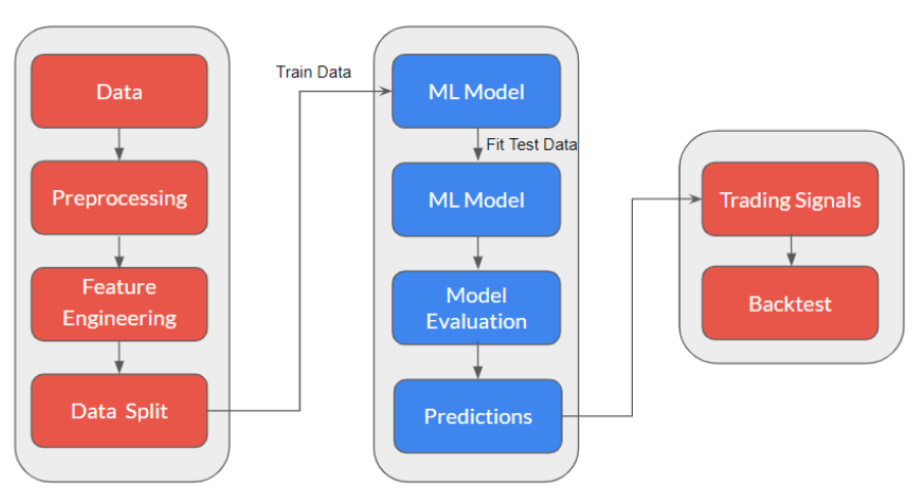

The need for machine learning in trading has grown significantly in recent years, as financial markets have become increasingly complex and competitive.

Machine learning techniques offer a powerful tool for traders and financial institutions to make sense of vast amounts of data, detect patterns, and make informed decisions in real-time. These algorithms can analyse historical market data, news sentiment, and a wide array of economic indicators to identify potential trading opportunities and manage risks more effectively. As markets become more data-driven and sophisticated, the integration of machine learning in trading is no longer a luxury but a necessity for those seeking a competitive edge.

One of the most prominent applications of machine learning is algorithmic trading, where machine learning models are employed to automate the execution of trades, optimising strategies, and responding to market changes at lightning speed.

The above chart is a general structure for using machine learning for trading. It involves the following steps:
1. Data Collection: This is already done: historical market data, such as stock prices, volume, and relevant economic indicators. We already collected data from trusted sources such as Coinbase API, ensuring data quality and accuracy.

2. Data Preprocessing: Before we input the data into the machine learning model, we should make sure that the data is correct. For example, in the table below, from 10:45 to 11:00am, the close price was $87. But from 11:15 to 11:30am it was recorded as $890. This means that there is some error in the data. Also, from 11:30 to 11:45am, the close price was 0, which seems odd. 

| Date-Time | Close |
| :--- | :---: |
| 2024-03-04 10:45:00-11:00:00 | $87  |
| 2024-03-04 11:00:00-11:15:00 | $890 |
| 2024-03-04 11:15:00-11:30:00 | $89  |
| 2024-03-04 11:30:00-11:45:00 | $0   |
These are a few things we should check before using the data further. There are various functions in Python which handle all pre-processing tasks efficiently.

3. Feature Engineering: To understand how feature engineering works in this context, let's put an example: Should we Buy/Sell Bitcoin now? A simple answer would be "If we are sure that Bitcoin will increase in the next 15 minutes or the next time period, then we will buy. This means we are trying to predict whether the Bitcoin price will move up or not in the next 15 minutes or next time period. Let’s introduce the concept of the target variable here. The target variable is what the machine learning model tries to predict to solve the problem statement. It is referred to as $Y$.

| Date-Time | Open | High | Low | Close | Volume | Candle | EMA9 | EMA21 | RSI14| Label |
| :--- | :---: | :--- | :---: | :--- | :---: | :--- | :---: | :--- | :---: | :---: |
| 2021-05-04 04:15:00+00:00 | 55677.1  |  55755.21   |  55634.5	 |  55755.2	 | 0.24	 | green | 55629.28	| 55668.84  | 58.015 | 1 |
| 2021-05-04 04:20:00+00:00 | 55707.06 |  55741.4	 |  55693.42 |  55733.91 | 0.27  | green | 55650.20	| 55674.75  | 57.29  | 1 |
| 2021-05-04 04:25:00+00:00 | 55730.0  |  55747.7	 |  55710.47 |  55747.7	 | 0.03  | green | 55669.70	| 55681.38  | 57.66  | 1 |
| 2021-05-04 04:30:00+00:00 | 55771.44 |  55786.3	 |  55721.71 |  55749.0	 | 0.10  | red	 | 55685.56	| 55687.53  | 57.69  | 0 |
| 2021-05-04 04:35:00+00:00 | 55749.64 |  55749.64   |  55669.8	 |  55669.8	 | 0.36  | red	 | 55682.41	| 55685.92  | 54.56  | 0 |
| 2021-05-04 04:40:00+00:00 | 55663.3  |  55775.88   |  55631.2	 |  55775.88 | 0.006 | green | 55701.10	| 55694.099 | 57.86  | 1 |

The above table is a data from BTC in 5-minute time period. I added a column called label. A candle has label 1 if the $Open < Close$ and vice versa. Each candle can have some statistical features, derived from various statistical formulas. I brought a few statistical values (in trading terminology, we call them indicators) such as EMA9, EMA21, and RSI14. Each of these indicators can be a feature for that candle. Now a technical question is raised: Given a list of indicators for a candle, can we predict the next price movement ? 

$ Candle_i = [EMA9, EMA21, RSI, ....] \rightarrow Candle_{i+1} ? $

Note that, this is a simple example. We will not limit ourselves with predicting only the next candle. This is an example to show how to map the price to a vector of features, which we call this $X$ as of now. $X$ can have many different features. Some of them are **statistical**, and some of them are **conceptual**. The conceptual features are the ones that should be derived from the market condition. There is no statistical formula or indicator that reflects the coceptual feature of the market condition. We will dig into this in more detail later. 

Before we can apply machine learning to a trading strategy, we have to train the model first. But a machine learning model expects features to be stationary so that it can learn properly. For example, some parameters such as Volume and RSI14 have very different ranges. We have to make sure that the features are stationary. Therefore, we have to apply scaling method to features.

4. Data Split: After feature scaling, we will split the $X$ and $Y$ datasets in the ratio 80:20 for **train** and **test**. We can use different ranges for train-test data split. 

5. Train Model with Training Data: In this step, we should choose a machine learning algorithm such as a decision tree, random forest, or neural network. The fact that which learning algorithm is suitable for us is highly dependent on the feature vector. In essence, the learning algorithm will check the features for a given time period and will try to understand which values will give the target variable as buy, which is represented by 1.

6. Fit Test Data on Model: Once the model is trained, we use the trained model to make predictions on the test dataset. The trained model will check the input feature values in the test dataset and try to predict whether the price will move up or not.

7. Evaluate the Model: Assess model performance using various metrics like accuracy, precision, recall, and F1-score for the model. Accuracy is basically checking how many times was the model right in predicting the correct class.

Continuous monitoring and optimisation are essential to keep the system adaptive and profitable in evolving market conditions.